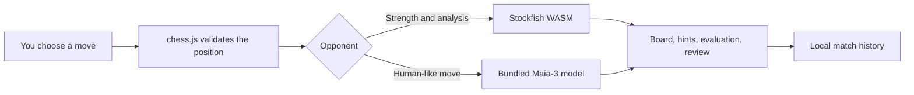
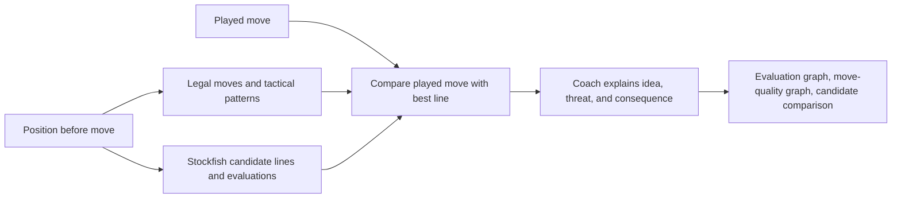

# Stockfish Helper

**A private, offline chess app for playing, analysing, and learning from your games.** Choose Stockfish for engine strength or Maia-3 for human-like moves. Play either color, explore alternate continuations, and review matches locally.

[Download Chess Helper 1.0.0 for Windows](https://github.com/harshpreett/stockfish_helper/releases/tag/v1.0.0) · [View the source](https://github.com/harshpreett/stockfish_helper)

> The Windows release includes its engines and model files. Gameplay does not require an internet connection, Python installation, or paid API.

## What it does

| Play | Analyse | Review |
| --- | --- | --- |
| Choose White or Black, engine, and difficulty | Stockfish evaluation and three candidate lines | Replay, import, and export PGN games |
| Undo your move or the bot’s move, then continue | Hint arrows for two candidate moves | Review move quality and save local match history |
| Flip and resize the board | Start from a custom FEN position | Search and favorite saved matches |

Games and settings are stored locally in the app profile; they do not sync between devices. Opening names and natural-language explanations are planned for a future release.

## How the app works



Stockfish runs in a browser worker. In the Windows desktop build, a small local server serves the interface only on the device; the app blocks requests to other hosts. Maia runs with its included 5M checkpoint and packaged CPU runtime.

## Planned: natural-language move coach

The next major feature is a coach that explains what happened in a position using engine evidence. The first version should use Stockfish evaluations and chess rules to produce clear, offline explanations. A language model can be considered later for more varied wording, while engine data remains the factual source.



### Coach goals and measures

These are **targets for the coach feature**, not claims about the current 1.0.0 app. All measurement stays on-device; the app will not send games or usage metrics anywhere.

| Measure | Initial target | What it improves |
| --- | ---: | --- |
| Explanation coverage | An explanation or clear “no major change” note for every reviewed ply | Makes review useful throughout the game |
| Evidence traceability | Every tactical or evaluation claim linked to a move, line, or board feature | Reduces vague or unsupported coaching |
| Explanation latency | Typical explanation within 2 seconds after analysis completes | Keeps feedback close to the move |
| Offline operation | 100% of coach features available without network access | Preserves the local-first design |
| User clarity | Let the player mark an explanation helpful or unclear, stored locally | Gives a private way to tune the coach |

### Graphs that could explain a game

- **Evaluation over time:** show advantage swings and mark the moves that caused them.
- **Move-quality timeline:** plot centipawn loss or review labels by move, with filters for each color.
- **Candidate comparison:** compare the played move with the top engine alternatives and their resulting evaluations.
- **Material balance:** show captured and remaining material over the game.
- **Accuracy summary:** summarize move quality by phase and side, with the scoring method shown.

The coach should distinguish verified engine facts from interpretation. “This move leaves the queen attacked” can be checked from the position; “you played this because…” is only a guess and should be phrased as a possibility.

## Run it locally

### Browser development

Requirements: Node.js 20 or newer.

```sh
npm install
npm run dev
```

Open the local address printed by Vite. Stockfish and Maia’s checkpoint are in the project. The development version also needs Maia’s Python dependencies installed on the development computer.

### Build the offline Windows installer

Use Windows, Node.js 20+, Git, and Python 3.12. The build computer needs internet once to fetch build dependencies; the resulting installer is self-contained.

```powershell
npm install
npm run package:windows
```

Output: `release/Chess-Helper-Setup-1.0.0.exe`. This is an unsigned x64 installer; Windows may show a publisher or SmartScreen warning. `npm run desktop` runs the desktop shell for development; `npm run dev` runs the browser version.

## Project map

| Path | Purpose |
| --- | --- |
| `index.html`, `src/main.js`, `src/style.css` | Interface, chess flow, and styling |
| `desktop/` | Electron shell, local server, and Maia UCI bridge |
| `public/engine/` | Local Stockfish JavaScript/WebAssembly files and license |
| `models/` | Maia-3 5M checkpoint and notices |
| `vendor/maia3/` | Maia-3 inference source |
| `scripts/package-maia.ps1` | Builds the packaged Maia CPU runtime |
| `assets/` | Green board (`9rdwe.png`) and Neo piece artwork (`ejgfv/`) |

## Engines and limits

- **Stockfish 19 Lite:** single-threaded WebAssembly; adjustable skill, depth, analysis, and candidate lines.
- **Maia-3 5M:** human-like move selection at a chosen rating; bundled in the Windows release.
- **Noctie:** not included as an offline engine.
- **Coach:** natural-language explanations and opening names are not in version 1.0.0; see the plan above.

## Licenses

Stockfish/Stockfish.js uses GPL-3.0 (`public/engine/Copying.txt`). Maia-3 source uses AGPL-3.0 (`vendor/maia3/LICENSE` and `models/AGPL-3.0.txt`). Maia’s checkpoint and license information are documented in [`models/README.md`](models/README.md) and the [Maia-3 model page](https://huggingface.co/UofTCSSLab/Maia3-5M).
