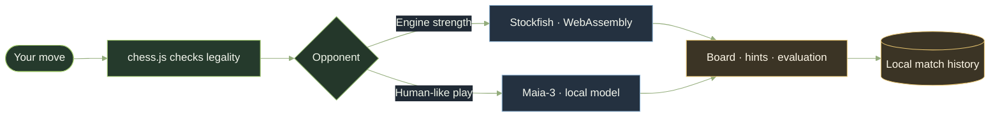
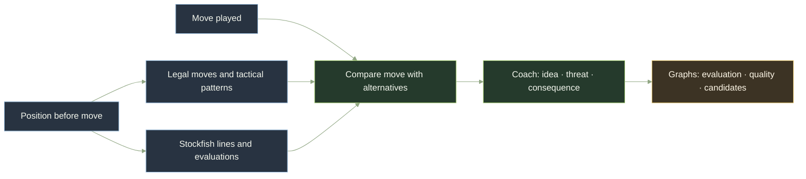

<div align="center">

# ♞ Stockfish Helper

### A private chess board, local engines, and a clearer way to review your games.

Play against Stockfish or Maia-3, analyse positions, and explore alternate continuations — all on your device.

[](https://github.com/harshpreett/stockfish_helper/releases/latest)


<br>

[**⬇ Download for Windows**](https://github.com/harshpreett/stockfish_helper/releases/tag/v1.0.0) · [Browse the code](https://github.com/harshpreett/stockfish_helper) · [See the coach roadmap ↓](#-next-up-a-natural-language-coach)

</div>

> [!NOTE]
> The Windows installer includes Stockfish, Maia-3, the model checkpoint, and Maia’s CPU runtime. The installed app needs no internet, Python, or paid API. The installer is unsigned, so Windows may show a publisher or SmartScreen warning.

## ✨ What you can do

| ♟ Play | 🔎 Analyse | 📚 Review |
| --- | --- | --- |
| Choose a side, engine, and difficulty | See evaluation and three candidate lines | Replay, import, and export PGN |
| Undo either side and continue from a new line | Get two-move hints with board arrows | Save, search, and favorite matches |
| Flip or resize the board; start from FEN | Adjust Stockfish strength and depth | Review move quality locally |

<p align="center"><b>Your games stay on this device.</b> Match history is stored in the app profile and does not sync across computers.</p>

## 🧭 How it works



In the Windows build, Electron opens the interface from a temporary local-only server. It accepts requests from the app itself and blocks requests to other hosts. Stockfish runs in a browser worker; Maia uses the included 5M checkpoint and packaged CPU runtime.

## 🧠 Next up: a natural-language coach

The next major release is planned around move explanations grounded in chess rules and Stockfish analysis. The coach should explain the move’s idea, what changed, and what the alternatives would have done. A language model could later make the wording more varied, but engine evidence should remain the source of chess facts.



### 📊 Coach goals

Targets for the planned coach feature — **not features of version 1.0.0**. Metrics and feedback stay local; no game or usage data is sent anywhere.

| KPI | Initial target | Why it matters |
| --- | --- | --- |
| Explanation coverage | Every reviewed move gets an explanation or “no major change” | Useful feedback across the whole game |
| Evidence traceability | Tactical and evaluation claims link to a line, move, or board feature | Explanations stay specific and checkable |
| Response time | Typical explanation within 2 seconds after analysis | Feedback arrives while the position is fresh |
| Offline availability | All coach features work without a network | Keeps the app private and self-contained |
| Clarity feedback | Helpful/unclear rating saved locally | Lets the coach improve without telemetry |

### 📈 Game graphs to add

| Graph | What it reveals |
| --- | --- |
| **Evaluation timeline** | Advantage swings, with the moves that caused them marked on the graph |
| **Move-quality timeline** | Accuracy or centipawn loss by move, filterable by side |
| **Candidate comparison** | Played move versus top alternatives and their resulting evaluations |
| **Material balance** | Material gained or lost as the game progresses |
| **Phase summary** | Move quality in the opening, middlegame, and endgame, with the scoring method shown |

Coach wording should separate evidence from interpretation. “The queen is attacked” is verifiable; “you played this because…” is an inference and should be presented as a possibility.

<details>
<summary><b>🗺️ Suggested delivery order</b></summary>

1. **Reliable analysis facts:** evaluation change, best line, legal threats, and tactical motifs.
2. **Coach explanations:** concise templates grounded in those facts, for both players’ moves.
3. **Visual review:** evaluation and move-quality graphs linked to the move list.
4. **Optional language model:** more natural phrasing, with claims restricted to verified engine evidence.

</details>

## 🚀 Run it locally

### Browser development

Requires Node.js 20 or newer. Maia’s development version also requires its Python dependencies on the development computer.

```sh
npm install
npm run dev
```

Open the local URL printed by Vite. Stockfish files and Maia’s checkpoint are already in the project.

### Build the self-contained Windows app

Use Windows, Node.js 20+, Git, and Python 3.12. The **build computer** needs internet once to fetch build dependencies; the resulting installer works offline on the target computer.

```powershell
npm install
npm run package:windows
```

Installer output: `release/Chess-Helper-Setup-1.0.0.exe`. Use `npm run desktop` to run the Electron shell during development, or `npm run dev` for the browser version.

## 🧰 Project map

| Location | Contents |
| --- | --- |
| `index.html`, `src/` | Interface, game flow, and styling |
| `desktop/` | Electron shell, local server, Maia UCI bridge |
| `public/engine/` | Stockfish JavaScript/WebAssembly and license |
| `models/` | Maia-3 5M checkpoint and notices |
| `vendor/maia3/` | Maia-3 inference source |
| `scripts/package-maia.ps1` | Packages Maia’s CPU runtime |
| `assets/` | Green board (`9rdwe.png`) and Neo pieces (`ejgfv/`) |

## ⚙️ Engines and current limits

- **Stockfish 19 Lite** — single-threaded WebAssembly; skill, depth, analysis, and candidate lines.
- **Maia-3 5M** — human-like move choice at a selected rating; bundled in the Windows release.
- **Noctie** — not included as an offline engine.
- **Coach and opening names** — planned; not part of version 1.0.0.

## 📄 Licenses

Stockfish/Stockfish.js is GPL-3.0 (`public/engine/Copying.txt`). Maia-3 source is AGPL-3.0 (`vendor/maia3/LICENSE`, `models/AGPL-3.0.txt`). Check [`models/README.md`](models/README.md) and the [Maia-3 model page](https://huggingface.co/UofTCSSLab/Maia3-5M) for checkpoint details.
